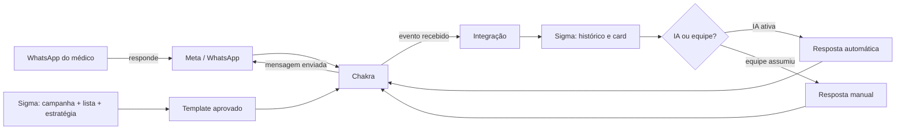

# Runbook técnico — Chakra ↔ Sigma GSS ↔ WhatsApp

**Objetivo:** documentar o que aprendemos na integração, como o fluxo deve funcionar, como validar cada etapa e como diagnosticar falhas sem concluir prematuramente que a conta ou o pagamento estão bloqueados.

**Escopo:** conexão de números em coexistência, templates, envio de primeira mensagem, recebimento, histórico no Sigma, janela de 24 horas, campanhas, IA/equipe e acompanhamento de eventos.

> **Segurança:** este documento não contém tokens, senhas, cookies, chaves privadas ou IDs que possam ser usados como credencial. Os valores reais devem ficar somente no gerenciador de segredos e nas configurações protegidas do ambiente.

---

## 1. Aprendizado principal

O número conectado demonstrou que era possível enviar e receber mensagens pela interface do Chakra. Ao mesmo tempo, uma tentativa iniciada pelo Sigma apresentou erro. Portanto, “não envia pelo Sigma” não significa automaticamente “a conta está bloqueada”.

O diagnóstico correto precisa separar quatro camadas:

1. **Meta/WhatsApp:** portfólio, conta empresarial, número, nome de exibição, qualidade, limites e aprovação do template.
2. **Chakra:** conexão do número, coexistência, seleção do remetente, templates disponíveis e envio pela interface.
3. **Integração:** eventos de entrada/saída, autenticação, destino dos eventos e atualização do histórico.
4. **Sigma:** campanha, lista, estratégia, remetente, janela de conversa, IA, tarefas e apresentação na UI.

Se uma camada funciona e outra não, o teste deve continuar isolando as camadas. Não devemos trocar número, apagar portfólio ou recriar templates antes de registrar o resultado de cada teste.

---

## 2. Visão do fluxo completo

### 2.1. Fluxo de saída

1. A equipe cria ou seleciona uma campanha no Sigma.
2. A campanha define lista, estratégia, remetente e tipo de envio.
3. Para iniciar uma conversa, o Sigma seleciona um template aprovado.
4. O Sigma envia ao conector do Chakra os dados do destinatário, remetente, template e variáveis.
5. O Chakra envia pela conta oficial/número selecionado.
6. O resultado precisa ser registrado como enviado, falho ou rejeitado, com horário e motivo legível.
7. A mensagem deve aparecer no celular e no histórico do Sigma.

### 2.2. Fluxo de entrada

1. O médico responde no WhatsApp.
2. O WhatsApp entrega o evento ao Chakra.
3. O Chakra encaminha o evento para a integração configurada.
4. O Sigma localiza o lead pelo número normalizado.
5. O Sigma grava a mensagem, atualiza o card, marca “respondeu” e aplica a estratégia da campanha.
6. Se a IA estiver ativa, ela pode responder uma vez por rodada de conversa; se alguém assumir, a IA deve parar.

---

## 3. Conexão de um novo número em coexistência

### 3.1. Pré-requisitos

- Número real, sob controle da empresa.
- Portfólio empresarial correto selecionado.
- Nome de exibição coerente com a razão social/marca documentada.
- Verificação em duas etapas ativa.
- Conta empresarial e forma de pagamento em situação regular.
- Plugin/conexão do Chakra criado para o ambiente correto.
- Nenhuma reutilização de credencial entre clientes ou projetos.

### 3.2. Sequência segura

1. Criar ou selecionar o portfólio correto.
2. Cadastrar o número e concluir a coexistência pelo fluxo oficial.
3. Confirmar no WhatsApp Manager o status do número.
4. Conferir nome, país, fuso, qualidade e limites.
5. No Chakra, selecionar explicitamente o número conectado.
6. No Sigma, cadastrar o número como remetente e associar o identificador correto.
7. Fazer um teste de recebimento pelo celular.
8. Fazer um teste de envio pela interface do Chakra.
9. Fazer um teste de envio pelo Sigma.
10. Conferir os três lugares: celular, Chakra e Sigma.

### 3.3. O que não pode ser presumido

- Cartão cadastrado não significa que o número esteja pronto.
- Portfólio aprovado não significa que todos os números estejam aprovados.
- Template aprovado em uma conta não é automaticamente aprovado em outra.
- Conexão criada no Chakra não garante que o Sigma esteja usando aquele remetente.
- Histórico antigo não migra automaticamente para um número novo.

---

## 4. Templates

### 4.1. Regras

- O template inicial deve existir na conta que fará o envio.
- O nome precisa ser único e estável.
- A categoria deve corresponder ao conteúdo.
- As variáveis precisam ter a quantidade, ordem e exemplos corretos.
- Usar texto simples, claro e sem caracteres quebrados.
- Evitar acentos apenas durante testes de diagnóstico; o conteúdo final deve ser português correto.
- Não reutilizar template rejeitado sem corrigir a causa.

### 4.2. Teste mínimo

Para cada template, registrar:

| Campo | Valor a registrar |
|---|---|
| Conta/portfólio | nome interno da conta |
| Número remetente | nome e telefone mascarado |
| Template | nome e categoria |
| Variáveis | valores usados no teste |
| Destinatário | número de teste autorizado |
| Horário | data e hora com fuso |
| Chakra | resultado na interface |
| Sigma | resultado na UI e no histórico |
| Celular | recebido, não recebido ou rejeitado |

### 4.3. Interpretação

- **Aparece como aprovado e envia no Chakra:** conta e template estão aptos para aquele caminho; investigar o Sigma.
- **Aprovado, mas falha no Chakra:** coletar resposta completa e abrir chamado no Chakra.
- **Não aparece na seleção:** template está em outra conta, outro idioma, outro número ou não sincronizou.
- **Envia, mas não aparece no Sigma:** investigar identificação do remetente, normalização do número e gravação do evento.

---

## 5. Webhook e eventos de integração

O webhook é o endereço para o qual o Chakra entrega notificações do WhatsApp. Ele é usado principalmente para mensagens recebidas, mudanças de status e alterações da conexão. Ele não é a mesma coisa que o endpoint usado para enviar uma mensagem.

### 5.1. Contrato esperado

| Parte | Responsabilidade |
|---|---|
| Chakra | entregar o evento e repetir quando não houver confirmação |
| Endpoint de entrada | validar origem, responder rapidamente e registrar o evento |
| Processador | normalizar, deduplicar e transformar o evento em atualização de negócio |
| Sigma | atualizar mensagem, lead, card, tarefa, IA e histórico |

### 5.2. Configuração mínima

- URL de produção definida para o ambiente correto.
- Segredo de validação guardado no ambiente seguro, nunca no código ou no navegador.
- Verificação inicial do endpoint concluída, quando o provedor exigir desafio.
- Aceitação de requisições `POST` com corpo JSON.
- Resposta `2xx` rápida após receber e validar o evento.
- Processamento pesado fora da resposta imediata.
- Registro de `event_id`, `message_id`, telefone, número remetente e horário.
- Reprocessamento seguro quando o Chakra repetir a entrega.

### 5.3. Eventos que precisam ser testados

1. Mensagem de texto recebida.
2. Áudio, imagem e documento recebidos.
3. Mensagem enviada pela equipe.
4. Mensagem enviada pela IA.
5. Confirmação de entrega.
6. Confirmação de leitura.
7. Falha de envio.
8. Número conectado.
9. Número desconectado.
10. Reautenticação ou troca de configuração.

### 5.4. Diagnóstico de resposta HTTP

- **2xx:** evento aceito; ainda é necessário confirmar o processamento no Sigma.
- **4xx:** configuração, autenticação ou formato rejeitado; não repetir indefinidamente.
- **5xx:** falha interna; registrar o evento, preservar o corpo original e permitir reprocessamento.
- **Sem resposta:** verificar disponibilidade, DNS, certificado e tempo de processamento.

Um erro `500` no endpoint de envio de template indica falha no caminho de saída. Ele não prova que o webhook de entrada está quebrado. Da mesma forma, mensagens que chegam no Chakra e não aparecem no Sigma apontam para a etapa de entrada/ processamento, não necessariamente para o envio.

### 5.5. Observabilidade mínima

Para cada tentativa, preservar:

- correlação do teste;
- origem (Chakra, Sigma ou celular);
- portfólio;
- número remetente;
- destinatário mascarado;
- template e variáveis sem dados sensíveis;
- status retornado;
- corpo de erro sanitizado;
- horário de envio, entrega e processamento;
- número de tentativas;
- resultado final no celular, Chakra e Sigma.

Criar uma fila de falhas para eventos que não puderam ser processados, com reprocessamento manual e limite de tentativas. Nunca gerar uma segunda mensagem apenas porque o evento original demorou.

## 6. Eventos e atualização do histórico

O conector precisa tratar pelo menos estas classes de eventos:

| Classe | O que significa | Ação no Sigma |
|---|---|---|
| Mensagem recebida | médico escreveu | gravar conteúdo, horário e remetente |
| Mensagem enviada | sistema/equipe enviou | gravar conteúdo e origem |
| Entrega | WhatsApp aceitou e entregou | atualizar status da mensagem |
| Leitura | destinatário abriu | atualizar status quando disponível |
| Falha | envio não concluído | gravar motivo legível e permitir reprocessamento seguro |
| Mídia | áudio, imagem, documento ou vídeo | guardar tipo, URL segura e estado de download |
| Alteração de conexão | número conectado, desconectado ou reautenticado | alertar responsável e bloquear disparo inseguro |

### 6.1. Regras de integração

- Validar a origem do evento.
- Aceitar reenvio do mesmo evento sem duplicar mensagem.
- Usar um identificador externo da mensagem para deduplicação.
- Normalizar telefones para o mesmo formato em todas as camadas.
- Registrar horário original e horário de processamento.
- Não marcar como “enviado” antes de receber confirmação do Chakra.
- Não mover o card apenas por uma tentativa; mover após o estado confirmado.
- Se o evento chegar fora de ordem, preservar o histórico pelo horário original.

### 6.2. Checklist de atualização

- A mensagem apareceu no celular?
- Apareceu no Chakra?
- Apareceu no Sigma sem atualizar a página?
- O card recebeu o indicador de resposta?
- O lead foi para a etapa correta?
- A IA foi pausada quando a equipe assumiu?
- O histórico mostra qual número enviou e recebeu?

---

## 7. Janela de 24 horas

- A janela começa a partir da resposta do médico, não do envio inicial do template.
- Enquanto a janela estiver aberta, a equipe pode enviar mensagens comuns pelo mesmo número.
- Depois da janela, uma nova mensagem iniciada pela empresa precisa de template aprovado.
- Se o médico responder novamente, abre-se uma nova janela.
- O card deve exibir claramente: “janela aberta”, tempo restante e ação recomendada.
- Respostas da IA dentro da janela não devem ser contadas como novas conversas iniciadas.

---

## 8. Diagnóstico do caso que investigamos

### Evidências observadas

- O número conseguiu trocar mensagens pela interface do Chakra.
- Um template aprovado apareceu na interface.
- O cartão e a conta empresarial apareciam como aprovados nas telas consultadas.
- Uma tentativa pelo caminho integrado do Sigma apresentou erro de servidor.
- Havia contas antigas, templates rejeitados, nomes antigos e dados de demonstração.

### Conclusão operacional

Não havia evidência suficiente para afirmar bloqueio total do número ou falta de pagamento. O cenário mais provável era divergência de configuração entre o remetente/template selecionado no Chakra e o remetente/template usado pelo Sigma, somada à poluição de cadastros antigos.

### Procedimento de confirmação

1. Selecionar explicitamente o número no Chakra.
2. Selecionar o mesmo número no Sigma.
3. Selecionar um template aprovado da mesma conta.
4. Enviar para um número de teste autorizado.
5. Comparar celular, Chakra e Sigma.
6. Repetir com uma campanha de um único lead.
7. Só depois ampliar a lista.

---

## 9. Campanhas no Sigma

### Campanha manual

- Seleciona lista ou leads específicos.
- Define estratégia e responsável.
- Seleciona remetente.
- Usa template quando necessário.
- Permite conversa da equipe após resposta.

### Campanha com IA

- Só deve aceitar leads incluídos explicitamente na campanha.
- Deve ter briefing, persona, objetivo e limites de resposta.
- Deve agrupar várias mensagens do médico antes de responder.
- Deve impedir respostas duplicadas.
- Deve parar quando alguém assumir o lead.
- Deve criar tags de operação, como “resposta recebida”, “aguardando equipe”, “janela aberta” e “não contatar”.

### Proteções obrigatórias

- Nunca adicionar leads automaticamente ao clicar em “Adicionar leads”.
- Exigir lista, seleção nominal ou filtro confirmado.
- Mostrar remetente, conta, template e estratégia antes de iniciar.
- Separar claramente envio oficial e envio não oficial.
- Bloquear contatos que pediram para não receber mensagens.
- Permitir pausar e retomar sem duplicar envios.

---

## 10. Coexistência e vários números

Uma mesma estrutura empresarial pode ter vários números, desde que cada um seja configurado e testado individualmente.

Para cada número, manter uma ficha com:

- Portfólio empresarial.
- Nome de exibição.
- Número e identificador interno.
- Conexão no Chakra.
- Remetente no Sigma.
- Templates disponíveis.
- Campanhas associadas.
- Data do último teste.
- Qualidade e observações.

O Sigma deve preservar qual número enviou e recebeu cada mensagem. O histórico pode ser unificado por lead, mas não pode esconder a origem da mensagem.

---

## 11. Selo azul/verificação oficial

O selo azul é uma etapa de confiança e descoberta. Ele não é necessário para o primeiro envio.

### Plano

1. Verificar o portfólio empresarial da GSS.
2. Usar razão social, CNPJ, endereço, site, e-mail e nome de exibição coerentes.
3. Ativar segurança em duas etapas nos números.
4. Manter o número com histórico de qualidade e sem denúncias.
5. Publicar presença real da marca: site, página oficial e informações de contato.
6. Evitar compra, transferência ou mistura de portfólios.
7. Evitar troca repetida de nome comercial.
8. Aguardar maturidade da conta e do número.
9. Solicitar a avaliação pelo WhatsApp Manager quando a opção estiver disponível.
10. Se houver recusa, corrigir a causa e respeitar o prazo para nova solicitação.

### Novas contas por CNPJ

- Criar somente contas de empresas reais do grupo.
- Usar documentação correspondente ao CNPJ.
- Associar usuários reais e ativar segurança.
- Usar domínio e e-mail coerentes.
- Definir finalidade de cada conta antes de criar.
- Não criar várias contas apenas para contornar limite ou bloqueio.
- Registrar responsável, documentos enviados e status de aprovação.

---

## 12. Monitoramento de produção

### Painel diário

- mensagens tentadas;
- mensagens confirmadas;
- falhas por motivo;
- respostas recebidas;
- leads aguardando equipe;
- janela de 24 horas aberta;
- conversas sem resposta;
- pedidos para não receber;
- qualidade do número;
- campanhas pausadas;
- diferença entre celular, Chakra e Sigma.

### Critérios de parada

Pausar o envio se ocorrer qualquer um destes sinais:

- bloqueio ou restrição do número;
- aumento de pedidos para não receber;
- mensagens repetidas;
- template errado;
- mensagens enviadas pelo remetente incorreto;
- envio confirmado no Sigma, mas ausente no celular;
- resposta recebida no celular, mas ausente no Sigma;
- IA respondendo depois da equipe assumir.

---

## 13. Checklist para outra sessão

Antes de investigar:

- [ ] Identificar portfólio e número envolvidos.
- [ ] Confirmar se o número está conectado no Chakra.
- [ ] Confirmar se o número aparece como remetente no Sigma.
- [ ] Conferir template e categoria.
- [ ] Conferir se a conversa está dentro ou fora de 24 horas.
- [ ] Fazer um teste unitário com um contato autorizado.
- [ ] Comparar celular, Chakra e Sigma.
- [ ] Registrar horário, template, remetente e resultado.
- [ ] Só então revisar campanha, IA ou infraestrutura.

Para abrir suporte do Chakra, enviar:

- nome do portfólio;
- número mascarado;
- nome do template;
- horário do teste;
- origem do envio (Chakra ou Sigma);
- destinatário de teste autorizado;
- resultado no celular;
- resultado no Chakra;
- resultado no Sigma;
- captura ou resposta completa do erro;
- sem enviar tokens, senhas ou dados desnecessários.

---

## 14. Decisões registradas

- O envio pela interface do Chakra é uma prova importante, mas não substitui o teste ponta a ponta.
- O Sigma deve mostrar erro legível, remetente, template e próximo passo.
- Templates, números e portfólios devem ser tratados como recursos separados.
- Toda campanha deve começar pequena e crescer somente após confirmação dos três pontos: celular, Chakra e Sigma.
- O selo azul é objetivo de médio prazo; qualidade, consentimento e consistência vêm antes.

**Documento preparado para reutilização em auditorias e novas sessões de diagnóstico.**
